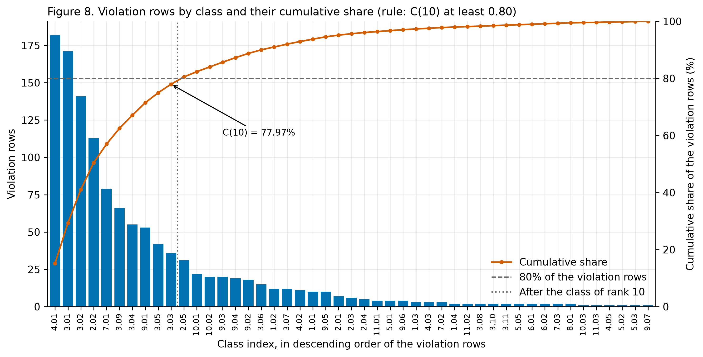
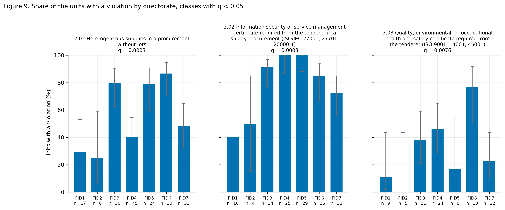
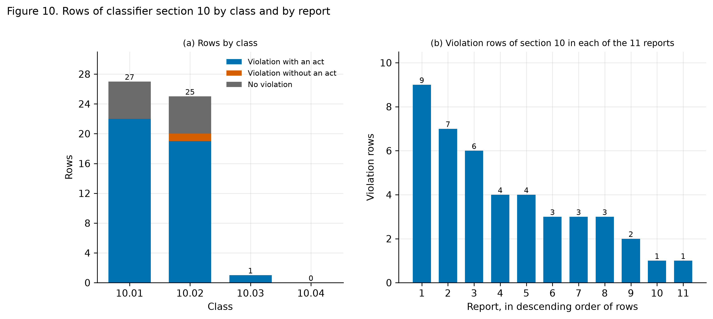
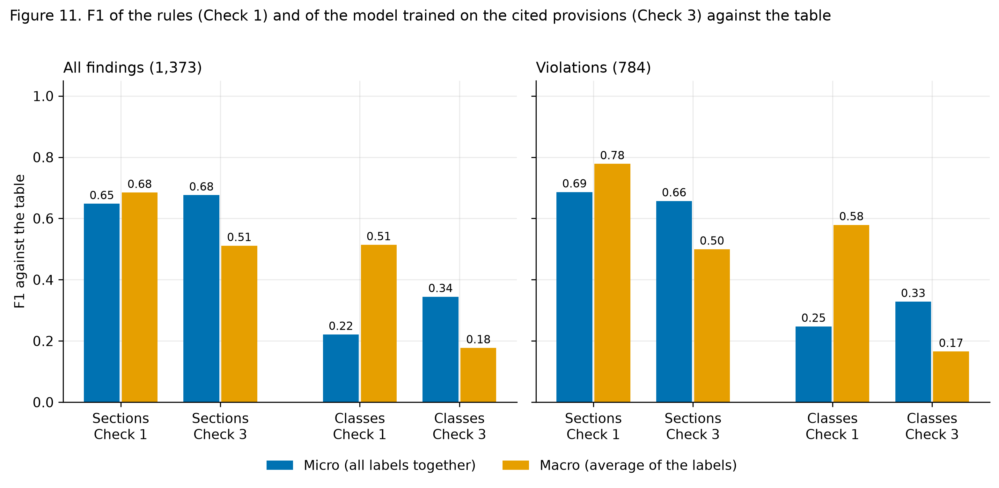

# Violation Types and Risk Indicators in Ex-Ante Financial Control

*Classification of the violations found by the Public Financial Inspection Agency (ADFI) in the procurements of schools under procedure BG-RRP-1.015 "School STEM Environment" of the National Recovery and Resilience Plan, and proof of its reliability*

**An indicator is not a proven violation.** The findings and administrative violation acts of the ADFI are formal administrative indicators. They remain subject to administrative-penal and judicial review. No school, municipality or person is accused of anything. The reports are a sample of the inspections.

## Objective

The study classifies the violations that the ADFI found in 560 inspection reports on schools (published from August 2024 to October 2026) by the **act of the contracting authority**, not by the article of the law, and shows how far the classification can be relied on. The classification was made by reading each finding in its report; the basis and the conclusion of the ADFI that each class rests on are kept beside every row in `data/adfi_classification_verbatim.csv`. The classifier has 11 sections and 53 classes.

The study answers three questions:

1. Do a few types of violation carry most of the violation rows? (H1a)
2. Is the same type of action recorded as a violation equally often in all seven directorates of the ADFI? (H1b)
3. How far can the classification be relied on? (Objective 1)

## Main results

| Question | Result |
|---|---|
| Reliability (Objective 1) | 1,136 of the 1,203 cases of violation (94.4 %; Wilson [92.99 %; 95.59 %]) take the type directly from the ADFI's words; 167 cases (13.9 %) in four stages rest more on a reading of the text |
| Concentration (H1a) | **Rejected.** The ten largest classes carry 77.97 % of the violation rows (cluster bootstrap [74.36 %; 82.10 %]); 11 classes are needed for 80 % |
| Directorates (H1b) | **Confirmed** in 3 of the 6 testable classes: heterogeneous supplies without lots (q = 0.0003), information-security certificate (q = 0.0003), quality, environmental or safety certificate (q = 0.0076) |
| Ex-ante control | 43 of the 1,203 violation rows (3.57 %) in 11 reports: 22 commitments or payments without ex-ante control and 20 without the double signature |
| Agreement with the cited provisions | Check 1, sections, micro F1 0.6862 [0.6667; 0.7054]; Check 3, sections, micro F1 0.6571 (findings with a violation); agreement with the table, not correctness |

<p align="center"></p>
<p align="center"><b>Concentration of the violation rows by class (H1a)</b></p>

<p align="center"></p>
<p align="center"><b>Share of violations by class and directorate (H1b)</b></p>

<p align="center"></p>
<p align="center"><b>Findings on ex-ante control (classifier section 10)</b></p>

<p align="center"></p>
<p align="center"><b>Check 1 (rules) and Check 3 (TF-IDF) against the table</b></p>

## Conclusions

In these conclusions a *case of violation* is one type of violation in one finding: the 784 findings with a violation make 1,203 cases, because a finding of several types is counted once in each of its types.

**1. The classification is a reliable record of what the ADFI found.** In 1,136 of the 1,203 cases of violation (94.4 %) the type of the violation is written in the ADFI's own words — in its conclusion, in its assessment or in the title of the check. Only 67 (5.6 %) rest on the author's reading. This means that the cases of violation of the study are counted as the inspectors wrote them, not as the author understands them.

**2. Half of the cases of violation are defects of the tender documentation that the ADFI names itself.** Four acts of the school — requiring the content of the technical proposal (work programme, strategy, approach to risk) as a condition for admission; requiring the tenderer to have its own service base; requiring an information-security or service-management certificate (ISO/IEC 27001, 27701, 20000-1) in a supply procurement; and putting heterogeneous supplies in one procurement without lots — are 607 of the 1,203 cases of violation (50.5 %), in 292 of the 410 reports with a violation. In 598 of them (98.5 %) the ADFI names the act itself. This means that half of what the inspectors found was visible in the documents before the school signed the contract and took on the commitment, and this conclusion does not depend on interpretation.

**3. The failure of the financial control itself is recorded reliably, but rarely.** In 22 cases a commitment was taken or a payment made without ex-ante control, and in 20 without the double signature. In 41 of these 42 cases the ADFI says so in its own words, and the article for ex-ante control and the double signature (Art. 13(3), items 3 and 1, FMCPSA) is cited in every one of them, so here the inspector's words and the cited law agree. The cases are in only 10 of the 410 reports. Almost everything else is recorded as a breach of the procurement rules: the PPA is cited in 1,094 of the 1,203 cases of violation (90.9 %). This means that the weakness of the control before a commitment shows in the reports mainly through the breaches of the PPA that it did not stop, and not as a separate breach of the FMCPSA.

**4. The article of the law does not say what was done; the ADFI's description does.** Art. 2(2) PPA alone (the ban on restricting competition) is cited in 254 findings with a violation that concern 16 different acts, from a required certificate to a required turnover or experience. The classification adds what the article cannot give: the concrete act, taken from the ADFI's words (876 of the 903 cases of violation in the documentation, 97.0 %). The conclusion and modification of the contract are different: there the article describes one act only (for example, a contract concluded without the documents presented), so the type is read from the article itself and the match with the law is no additional evidence; the certainty comes from the ADFI's text (85 of 86 cases). This means that a controller who works only with the cited article cannot tell what the school did; the classification by act tells it.

**5. Where the record is less certain.** In the choice of the award procedure 12 of 27 cases are in the ADFI's words. The direct award at a value that requires a call or a procedure is not named in the ADFI's words in any of its 12 cases: the author recognised it by reading the ADFI's description, and the articles that the ADFI cites on the value and the choice of procedure (Art. 17 and Art. 20 PPA) point to the same act in 11 of the 12. In the launching of the procurement 3 of 8 cases are in the ADFI's words, in publicity and the procurement dossier 110 of 125, and in payments under other statutes 5 of 7; together these are 167 cases of violation (13.9 %). This means that the conclusions on these stages are weaker; above all the direct award, an indicator of the irregularity scheme “splitting of procurements and unjustified direct award”, is recognised by a reading confirmed by the law, not by the inspector's words.

**6. What the study cannot say.** The record has only one finding of a missing internal procedure for ex-ante control and none on the ex-ante control under Art. 237b PPA. This means that the study says nothing on these two controls: the absence of a finding is not proof that the control was done.

**7. The same act is assessed differently by different directorates.** For heterogeneous supplies without lots, for the information-security certificate and for the quality, environmental or safety certificate (ISO 9001, 14001, 45001) the share of cases assessed as a violation differs between the directorates. In the first act both the violations and the assessments of no violation are in the ADFI's words; for the two certificates the assessments of no violation are mostly the author's reading (3 of 27 and 17 of 72 in the ADFI's words). This means that the inspectors do not treat these requirements uniformly, and for the certificates the evidence of the difference is weaker where no violation was found. It does not mean that any directorate is wrong.

**Is the classification reliable?** Yes. In 94 of every 100 cases of violation the type is as the ADFI wrote it. This holds almost fully for the violations in the documentation and in the financial control, which carry the conclusions of the study. The record is weaker for the choice of the award procedure (above all the direct award), the launching, publicity and payments under other statutes, 167 cases of violation in all, and for the assessments of no violation on certificates. The study proves no violation: it describes what the inspectors recorded in a sample of the reports, and every count is an **indicator**.

## Methodology

- **Units.** Report (560; 488 with rows), finding (1,373; 784 with a violation), row = finding × class (1,824; 1,203 with a violation). The counts are reconciled with the classifier before any test.
- **Check 1 — rules on the cited provisions.** A rule classifier that sees only the cited provisions predicts the section and the class of each finding from the provision → class map of the classifier; precision, recall and F1 with a cluster bootstrap by report (2,000 replications). It measures internal consistency, not correctness.
- **Check 2 — every row against the text of the ADFI.** Each of the 1,824 rows is checked against the verbatim basis and conclusion of the ADFI; the share of rows whose class is taken directly from the text is given with the interval of Wilson, overall and by section. No coefficient of agreement is computed.
- **Check 3 — supervised model.** TF-IDF on the cited provisions with one-vs-rest logistic regression, sections and classes, 5 folds grouped by report.
- **H1a.** Confirmed if at most 10 of the 53 classes carry at least 80 % of the violation rows; cluster bootstrap by report.
- **H1b.** Unit report × class; for each class with at least 10 units of each outcome a permutation χ² test (10,000 permutations), Cramér's V and the Benjamini–Hochberg adjustment; confirmed if q < 0.05 in at least one class.
- The decision rules were fixed before the computation. A result that does not confirm a hypothesis is reported as fully as one that does.

## Structure of the notebook

| Part | Content |
|---|---|
| Introduction, Theoretical background | Ex-ante control, the ADFI reports, the previous study |
| 1 | Purpose, questions, hypotheses, decision rules, scope |
| 2 | Data, personal-data scan, classifier, reconciliation, units |
| 3 | Check 1: rules on the cited provisions |
| 4 | Check 2: every row against the text of the ADFI |
| 5 | Question 1: concentration of the violation types (H1a) |
| 6 | Question 2: differences between the directorates (H1b) |
| 7 | Findings on ex-ante control (classifier section 10) |
| 8 | Check 3: TF-IDF with grouped cross-validation |
| 9 | Scope and limitations |
| 10 | Conclusions: results table, hypotheses, reliability, conclusions for financial control |
| Manifest, References | `data/MANIFEST.csv`; sources |

## Replication

Requirements: Python 3.13 and the packages in `requirements.txt` (pinned with `==`); CPU only.

```
python -m pip install -r requirements.txt
```

```
jupyter nbconvert --to notebook --execute --inplace ADFI_Violations_Classification.ipynb
```

- The run writes the tables to `data/derived/` (all results in `data/derived/conclusions_summary.csv`), the figures to `fig/` (PNG, 300 dpi) and `data/MANIFEST.csv` (size, SHA-256, source, date).
- If `data/adfi_classification.csv` is missing or differs, the notebook downloads it from `beluhov/stem-collusion-npvu` at commit `c5feef1` and checks its SHA-256.
- The texts of the reports are not in the repository.

## Repository

| File / Directory | Description |
|---|---|
| `ADFI_Violations_Classification.ipynb` | The notebook of the study |
| `requirements.txt` | Pinned package versions |
| `data/` | Classification table, verbatim basis and conclusion of the ADFI, report metadata, `MANIFEST.csv` |
| `data/derived/` | Tables written by the notebook |
| `fig/` | Figures written by the notebook |
| `LICENSE.txt` | MIT |

## Sources

- ADFI inspection reports: <https://www.adfi.minfin.bg/bg/34>
- Classification table: <https://github.com/beluhov/stem-collusion-npvu> (commit `c5feef1`)

*The literature, laws and regulations are referenced at the end of the notebook.*

## Disclaimer

The counts and shares are indicators that describe what the inspectors recorded in a sample of the reports. They are not findings of a violation by any school, municipality or person, and a difference between directorates does not show that any directorate is wrong.
